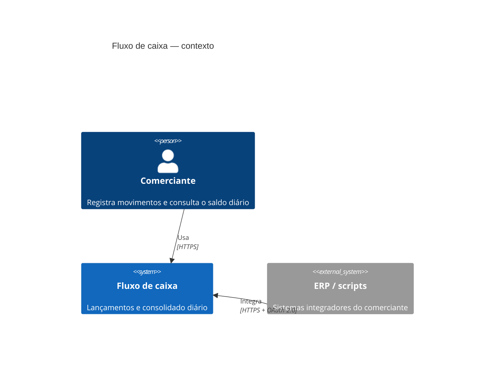
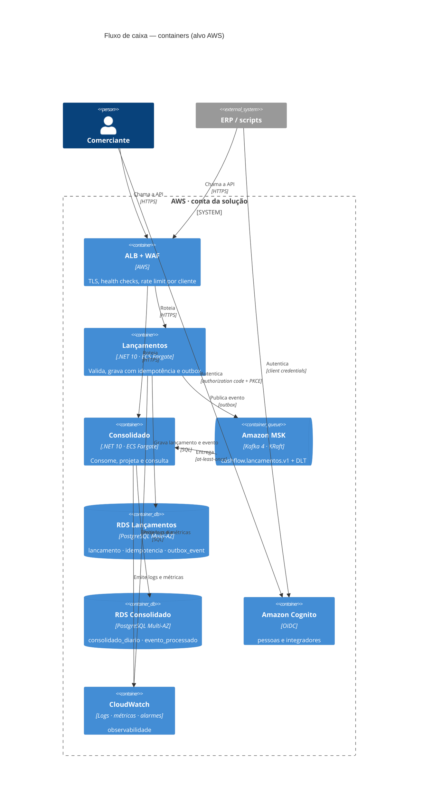

# Arquitetura-alvo — fluxo de caixa

O desenho-base é o [ADR-010](../requisitos/Arquietura-solucao-v2.png), código impresso no próprio diagrama do enunciado — não é o [ADR-0010](../ultron/agents/adr/0010-frontend-blazor-bff.md) da série local, que trata do frontend. Este documento registra a leitura em texto: o contexto, os containers, o fluxo de dados, o modelo de consistência e como cada requisito não funcional é atendido. As decisões estão nos [ADRs](../ultron/agents/adr/), aceitos em 18/11/2026.

## Contexto

Um comerciante precisa registrar débitos e créditos, corrigir sem apagar o histórico e consultar o saldo diário consolidado. Os integradores (ERP, scripts) fazem o mesmo por API. O serviço de lançamentos não pode ficar indisponível quando o consolidado cai; em pico, o consolidado recebe 50 requisições por segundo com no máximo 5% de perda.

## Containers

Os dois bancos lógicos vivem na **mesma instância RDS Multi-AZ** no MVP (ADR-0003). A separação é lógica, não física: uma queda da instância afeta os dois serviços; o RNF-1 é atendido no nível da aplicação, e a separação física é a evolução registrada.

## O desenho AWS

| Peça | Serviço | Papel |
|---|---|---|
| Entrada | Route 53 + ALB + WAF | Resolução, TLS, distribuição entre AZs, regras gerenciadas e rate limit |
| Identidade | Cognito | Pessoas (authorization code + PKCE) e integradores (client credentials) |
| Aplicação | ECS Fargate | Duas tasks por serviço, em AZs distintas |
| Eventos | Amazon MSK (Kafka 4, KRaft) | Tópico `cashflow.lancamentos.v1`, chave `comercianteId`, DLT com 30 dias |
| Dados | RDS PostgreSQL Multi-AZ | Dois bancos lógicos, usuários próprios por serviço |
| Segredos | Secrets Manager + KMS | Senhas acessadas por IAM; criptografia em repouso |
| Observabilidade | CloudWatch | Logs JSON, métricas e alarmes |

## O modelo de consistência

- **Escrita:** o lançamento, a chave de idempotência e o evento de outbox são gravados na mesma transação. Se algo falha, tudo reverte.
- **Publicação:** o publicador lê os eventos pendentes com `FOR UPDATE SKIP LOCKED`, publica com `acks=all` e marca `publicado_em`. A entrega é **ao menos uma vez**.
- **Consumo:** o consumidor valida o envelope, registra o `eventId` em `evento_processado` e aplica o valor assinado à projeção na mesma transação. Duplicata é ignorada; a falha persistente vai para a DLT após 1 + 3 tentativas (1 s, 2 s, 4 s).
- **Leitura:** `consolidado_diario` guarda `saldo_dia` e `saldo_acumulado` por comerciante e dia. `saldo_anterior = saldo_acumulado - saldo_dia`; a leitura é O(1).
- **Sinal:** crédito soma, débito subtrai. O estorno é um novo lançamento de tipo oposto.
- **Dia:** o dia do lançamento é o do registro, no fuso do comerciante (`America/Sao_Paulo`), atribuído pelo servidor. Retroativo fica fora do MVP (ADR-0005).

## Requisitos não funcionais

| Requisito | Como o desenho atende |
|---|---|
| Lançamentos disponíveis com o consolidado fora | Serviços separados; a escrita não chama o consolidado; o evento espera no outbox. Provado no teste de isolamento. |
| Consolidado a 50 req/s com ≥95% de sucesso | Leitura O(1) na projeção; escala horizontal das tasks; teste de carga na suíte. |
| Disponibilidade e recuperação (metas propostas) | Multi-AZ no RDS e nas tasks; RPO/RTO a validar no alvo (PRD, RNF-3 a RNF-5). |
| Consistência | Outbox transacional; consumo idempotente; 0 efeitos duplicados nos testes. |
| Segurança | OIDC, escopos, WAF, TLS, segredos no Secrets Manager, criptografia em repouso. |
| Observabilidade | Logs JSON com `requestId`/`traceId`; métricas de outbox, lag, DLT, 5xx. Ver [observabilidade](observabilidade.md). |

## Decisões

[ADR-0001](../ultron/agents/adr/0001-dois-servicos-outbox-projecao.md) (dois serviços com outbox e projeção) · [ADR-0002](../ultron/agents/adr/0002-kafka-kraft-barramento.md) (Kafka em KRaft) · [ADR-0003](../ultron/agents/adr/0003-postgresql-bancos-logicos.md) (bancos lógicos na mesma instância) · [ADR-0004](../ultron/agents/adr/0004-idempotencia-e-estorno.md) (idempotência e estorno) · [ADR-0005](../ultron/agents/adr/0005-projecao-consolidado.md) (projeção e dia do registro) · [ADR-0006](../ultron/agents/adr/0006-stack-dotnet-10.md) (stack .NET 10).

## O que roda no MVP

O `compose.yaml` sobe PostgreSQL, Kafka 4 em KRaft, os dois serviços, ELK e Prometheus/Grafana. As migrações rodam na subida; o roteiro do demo está no [README](../../README.md). O alvo AWS não é provisionado — é desenho.
