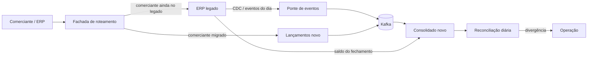

# Arquitetura de transição — do legado ao fluxo de caixa

*Diferencial do desafio. O cenário de legado abaixo é uma **suposição declarada** — o desafio não fornece o sistema existente. As decisões mudam com o inventário real; o método (strangler + reconciliação + corte por comerciante) permanece.*

## O cenário assumido

Um ERP ou sistema financeiro monolítico mantém o fluxo de caixa em uma base única, com:

- lançamentos editáveis na mesma tabela (correção por `UPDATE`, sem trilha);
- consolidação por rotina em lote, na madrugada;
- integradores chamando o banco ou uma API sem idempotência;
- um fechamento diário que ninguém consegue reproduzir.

Nesse cenário, a migração não pode ser um "big bang": o comerciante não pode parar de registrar movimento, e o saldo não pode divergir no dia do corte.

## A estratégia

**Strangler fig com dupla execução e corte por comerciante.**

### Fases

1. **Inventário e congelamento de regra.** Mapear os tipos de lançamento, as regras de estorno e o calendário de fechamento do legado. Nada muda ainda; o baseline de reconciliação nasce aqui.
2. **Espelho de leitura.** O Consolidado novo passa a receber os eventos do legado por CDC (Debezium lendo o WAL) ou por uma ponte de outbox, e calcula o saldo em paralelo. O comerciante continua lendo o legado; a operação compara os dois saldos todos os dias.
3. **Escrita em sombra.** Os lançamentos novos passam a ser gravados também no serviço novo, sem tráfego oficial. A reconciliação compara lançamento a lançamento (valor, tipo, dia, comerciante); a divergência vira backlog de correção.
4. **Corte por comerciante.** A fachada de roteamento manda a escrita e a leitura de um comerciante para o novo serviço, com uma chave de ativação. O legado permanece como leitura de fallback por um período; o corte é reversível.
5. **Descomissionamento.** Após o período de estabilidade (os saldos reconciliados por N dias), o legado sai do caminho do fluxo de caixa e fica apenas para o histórico que a lei exigir.

### A ponte do legado

Duas opções, com o mesmo contrato de evento do novo serviço:

- **CDC (Debezium):** lê o WAL do banco do legado e publica no Kafka no formato do envelope. Não exige alterar o legado, mas exige `REPLICA IDENTITY` e cuidado com o slot de replicação.
- **Outbox no legado:** uma tabela de eventos e um publicador no processo existente. Exige uma alteração controlada no legado, mas dá controle sobre o schema do evento.

O evento do legado precisa carregar o **dia de negócio** e o **estorno** com a semântica do novo desenho: estorno é contra-lançamento, não edição. Lançamentos do legado que não têm essa informação viram um **backfill** explícito.

### Reconciliação

A peça que dá segurança ao corte:

- **Diária:** para cada comerciante e dia, o saldo do legado e o saldo da projeção; a diferença vira um alerta e um item de operação. O saldo do legado no fechamento é a referência.
- **Por lançamento na sombra:** a soma e a contagem por comerciante e dia, com o `id` do legado como chave de correlação.
- A reconciliação **não corrige sozinha**: uma divergência é investigada e corrigida por um lançamento ou por um backfill, com trilha.

## Riscos e mitigação

| Risco | Mitigação |
|---|---|
| Duplicar lançamento na transição (o legado e o novo gravam o mesmo movimento) | Chave de idempotência compartilhada ou `id` do legado como chave externa; a fachada decide um único destino por comerciante |
| Saldo divergir no dia do corte | Dupla execução + reconciliação; o corte só acontece com N dias de saldo reconciliado |
| Evento do legado sem o dia ou sem o estorno correto | Backfill explícito; o lançamento sem semântica não entra na projeção |
| Falha do CDC (slot de replicação enchendo o disco) | Monitorar o slot; `max_slot_wal_keep_size`; alarme; a ponte não pode ser o único caminho da verdade |
| O legado cair durante a sombra | O novo serviço já está de pé; a fachada pode rotear o comerciante migrado; o legado é o fallback temporário |
| Autenticação diferente entre os mundos | O Cognito é a fonte; o legado recebe um adaptador; o token vale nos dois durante a transição |
| Corte sem volta | A chave da fachada é reversível; o legado fica como leitura de fallback por um período |

## Critérios de corte

Um comerciante migra quando:

- a reconciliação dos últimos 7 dias fechou sem divergência;
- a escrita em sombra cobriu 100% dos lançamentos do período;
- os integradores daquele comerciante foram avisados e testaram o novo contrato (idempotência e erros);
- a operação sabe reverter em uma chave.

## O que o MVP já prova

O que a transição depende — idempotência, outbox, consumo idempotente, projeção reconstruível e reconciliação por saldo — está implementado e testado no MVP. O que falta para a transição real é o inventário do legado, a ponte (CDC ou outbox) e a fachada de roteamento.
